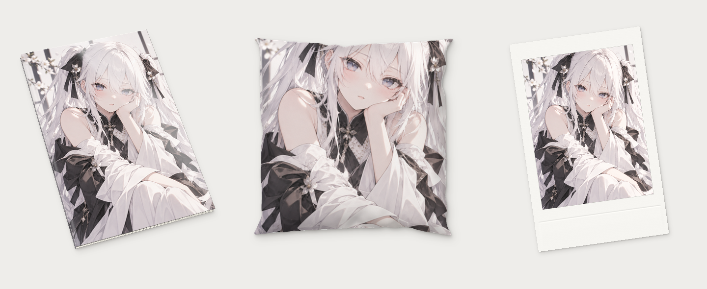

# Mocknido · 模巢

**多物料渲染工作室**

把一张设计图放进画册、抱枕或相纸，调整角度、材质与取景，导出带柔影的透明 PNG。所有图片均在本机处理。



## 下载与使用

在 [Releases](https://github.com/YuchanHu/mocknido/releases/latest) 下载 `Mocknido-v1.0.0-Windows-x64.zip`，完整解压后双击 **启动模巢.bat**。

便携版内置 Python 和运行依赖，无需安装 Python，可离线使用。支持 Windows 10 / 11 x64，需要已安装浏览器；已在其他电脑验证使用。启动窗口需保持打开，关闭窗口即可退出。首次抱枕渲染会编译缓存，请稍候。

若浏览器没有自动打开，请将启动窗口中的 `http://127.0.0.1:端口` 地址复制到浏览器。请先解压完整文件夹，再启动。

## 支持的物料

| 物料 | 调整项 |
| --- | --- |
| 写真画册 | 封面比例跟随图片；书本厚度、覆膜反光与三轴旋转 |
| 定制抱枕 | 1:1、2:3、1:2；饱满度、褶皱强度、布面光泽与三轴旋转 |
| 拍立得 | Polaroid 600 / i-Type、instax mini、instax WIDE；表面反光与三轴旋转 |

抱枕和拍立得支持居中铺满、完整显示、手动裁切。拖动画面可调整俯仰和侧转，按住 Shift 横向拖动可调整平面旋转。各菜单保留本次会话中的图片及参数，刷新页面或重启后重置。

导出宽度为 1600、2400 或 3600 像素，包含物料、光照和半透明阴影；棋盘格仅用于预览。输出用于效果展示，不作为印刷尺寸母版。

## 从源码运行

建议使用 Python 3.12，在项目根目录执行：

```powershell
python -m venv .venv
.venv\Scripts\python -m pip install -r requirements.txt
.venv\Scripts\python scripts/render_photobook.py --gui
```

源码包不包含便携运行时。`sample.png` 是默认示例，可在界面中替换为自己的图片。

```powershell
python scripts/render_photobook.py --cover design.png --output deliverables/book.png --width 2400
python scripts/render_pillow.py --cover design.png --ratio 2:3 --output deliverables/pillow.png --width 2400
```

## 开发与打包

- [使用说明](docs/USAGE.md)
- [便携版构建与验收](docs/BUILD.md)
- [更新记录](CHANGELOG.md)
- [依赖与素材说明](THIRD_PARTY_NOTICES.md)

## 名字的由来

**Mock** 取自 Mockup，指向产品效果图与商品渲染；**Nido** 在西班牙语和意大利语中意为“巢”。模巢是安放设计、试验物料效果的一处工作台。

## 许可

源码采用 [MIT License](LICENSE)。示例图片、抱枕底模及第三方依赖不纳入源码 MIT 授权，具体见 [依赖与素材说明](THIRD_PARTY_NOTICES.md)。
